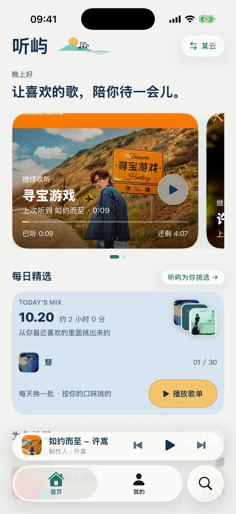
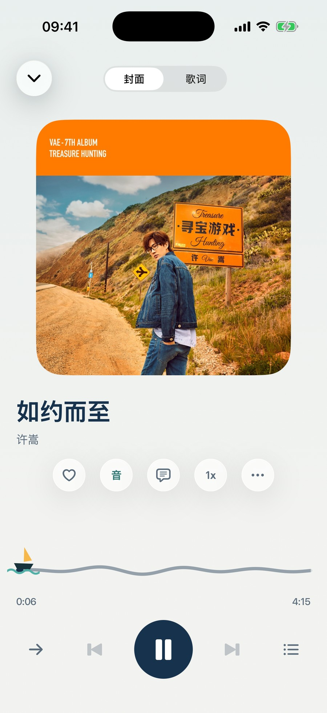
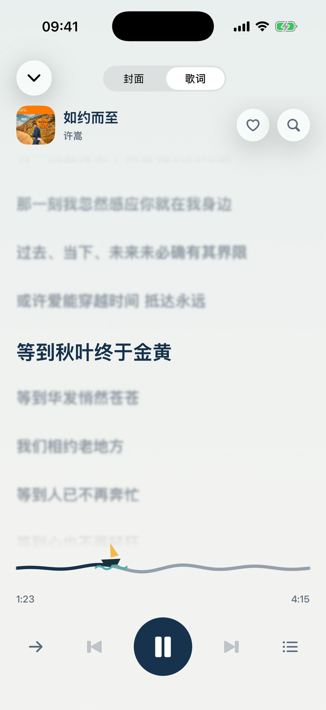
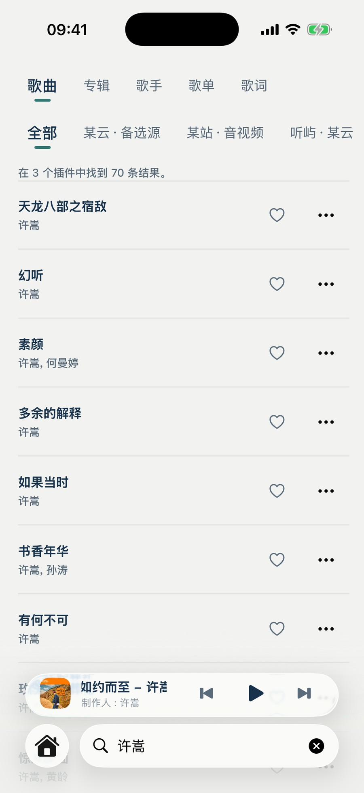
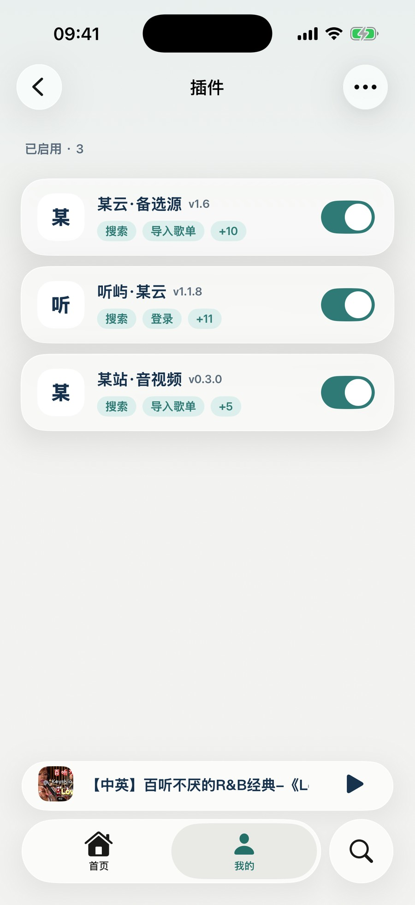
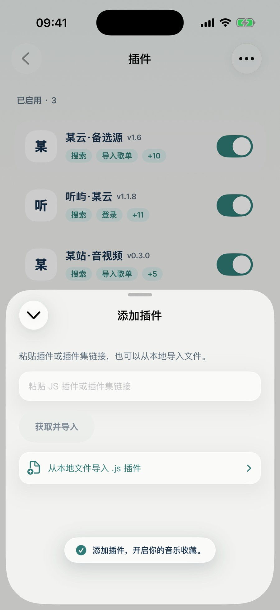
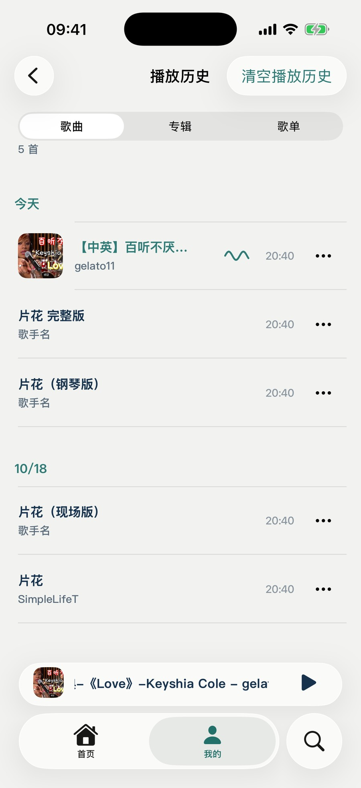
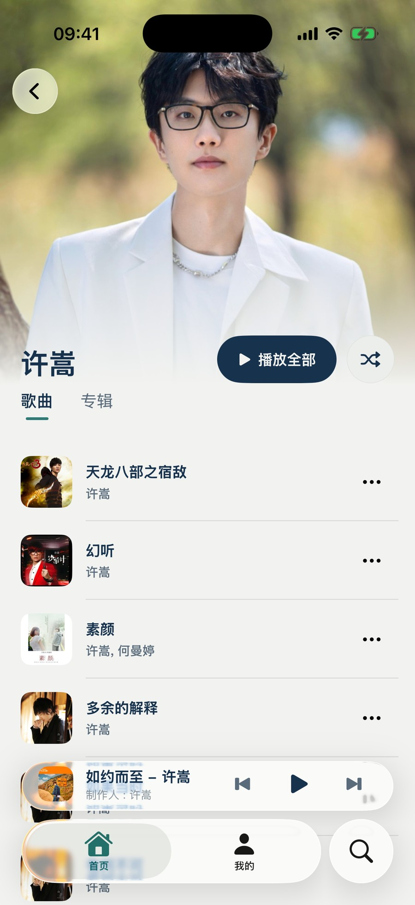
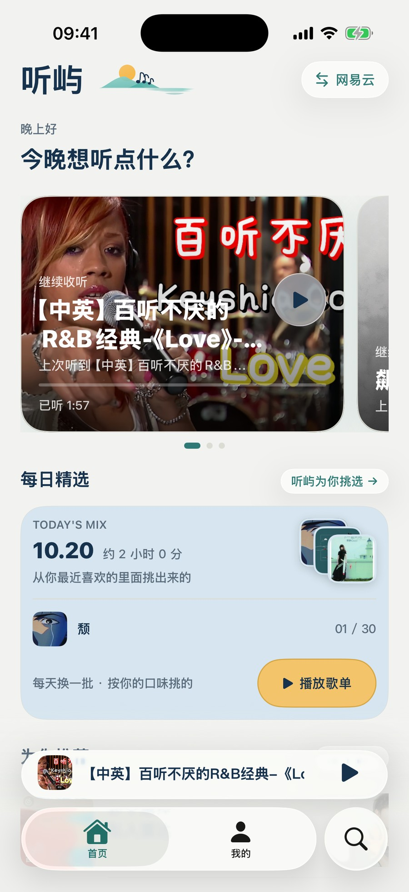
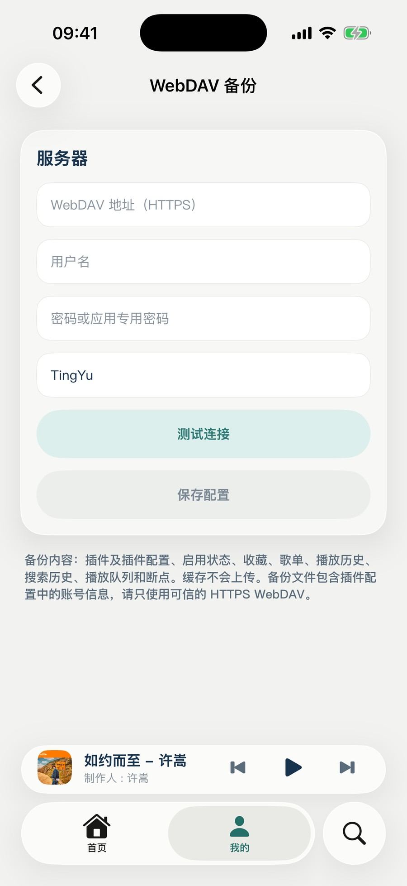

# 听屿

听屿是 iPhone 上的音乐播放器，名字取「听歌的小岛」。

界面用月白和海青两种颜色，插画是纸感的，海面、小船、灯都在里面出现过。设计上尽量安静，把听歌这件事放在前面。

## 界面

<table>
<tr>
<td align="center" width="50%"> 首页 · 继续收听和每日精选</td>
<td align="center" width="50%"> 播放页 · 全屏封面</td>
</tr>
<tr>
<td align="center"> 歌词 · 逐行跟唱</td>
<td align="center"> 搜索 · 歌曲、专辑、歌手、歌单</td>
</tr>
<tr>
<td align="center"> 插件 · 启用的源和它的能力</td>
<td align="center"> 添加插件 · 链接或本地文件</td>
</tr>
<tr>
<td align="center"> 播放历史 · 按天分组</td>
<td align="center"> 歌手页 · 顺着作品往下听</td>
</tr>
<tr>
<td align="center"> 迷你播放器</td>
<td align="center"> WebDAV 备份</td>
</tr>
</table>

## 能做什么

- **搜索**：歌曲、专辑、歌手、歌单分四类，滚动到底自动加载更多。
- **详情**：专辑、歌单、歌手各自成页，支持整张播放；歌手页可以顺着作品继续往下找。
- **播放页**：全屏封面，上滑切歌词，进度条是一条会随播放起伏的浪。
- **队列**：正在播放和接下来要播的分开排，右下角一键回到当前这首。
- **收藏与歌单**：收藏单曲，也能自己建歌单，搜索结果可以整首或整张放进去。
- **播放历史**：歌曲、专辑、歌单三个页签，点哪一条就从哪一条接着放。
- **继续收听**：长按桌面图标，直接回到上次听到的地方。
- **后台与锁屏**：切到后台继续播，锁屏和耳机都能控制；下次打开还在那一首、那个位置。
- **备份**：WebDAV 备份插件和它的配置、收藏、歌单、播放历史、搜索历史、队列和断点，换设备能接上；缓存不上传。

## 插件

听屿通过 MusicFree 的插件协议接入音乐服务。插件可以是链接、本地文件，也可以是一整个插件集。登录和续期由插件自己负责，听屿只管界面和播放。

协议来自 MusicFree 项目：[github.com/maotoumao/MusicFree](https://github.com/maotoumao/MusicFree)。

插件能不能用，取决于上游服务当下的状态：有的站点会拦请求，有的接口会变。失败的时候界面会写清楚原因，不会一直转圈。

## 下载

到 [Releases](../../releases) 下载最新一版的 `.ipa`。每个版本的说明里写了改了什么，以及包的 SHA-256。

包没有签名，用 Sideloadly、AltStore、ESign 这类工具，拿自己的证书签一遍再装，Bundle ID 是 `com.zxp.tingyu`。签名过期重新签一次就行，App 里的数据不会丢。

## 系统要求

iOS 26 及以上。
